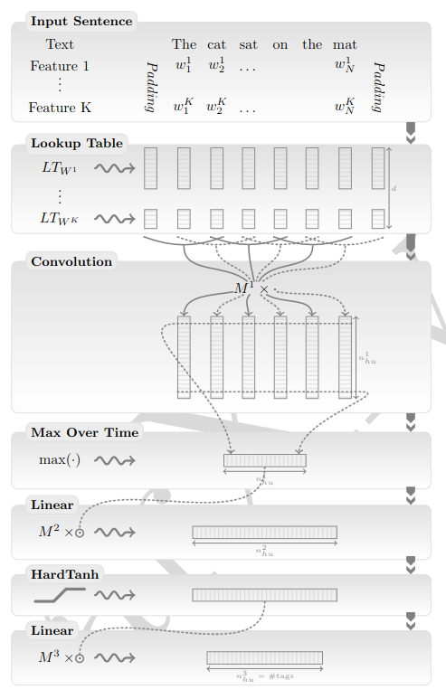

So far, the retro reproduction series has covered architectures that were significant (at the time) for language modeling [1] and computer vision [2]. After these reproductions, a natural next step is to combine the idea of learned token embeddings from [1] with the convolutional layers used for digit classification in [2], and apply them to language modeling.

As a reminder, [1] introduced learned embeddings for the words of an n-gram. The embeddings were concatenated and passed to a hidden non-linear layer `H`, which compressed them into a smaller feature vector used to predict the next word. The layer `H` can therefore be seen as a way of letting the embeddings communicate with each other, much like the attention mechanism in the transformer architecture. Both attention and the layer `H` essentially let embeddings communicate, producing new feature vectors that should hopefully help the subsequent layers predict the next token correctly.

Convolutional layers in [2] use learned weights to compress and blend pixel information from image regions into a smaller feature vector, which should also hopefully help the subsequent layers classify the image correctly.

A sentence can be represented as a 1D sequence of words, and each word can be turned into a numerical vector using learned embeddings. So why not use convolutional layers to let the tokens within a window communicate, extract a smaller feature vector, and use it for a language modeling task?

Unsurprisingly, this idea had already been explored in the 2011 paper "Natural Language Processing (Almost) from Scratch" by Ronan Collobert et al. [3]. The architecture presented there has two variants (the window approach and the sentence approach networks) and was designed to solve the following tasks: Part-Of-Speech tagging (POS), chunking (CHUNK), Named Entity Recognition (NER) and Semantic Role Labeling (SRL). These tasks are not of particular interest to me, nor do I have experience working with them. So I adapt the sentence approach network for next-token prediction. This variant was primarily designed for the NER and SRL tasks, where, as the authors state, there are dependencies between word tags across the sentence and the window approach fails. The sentence network architecture diagram is shown below (fig. 1).



Figure 1 - Sentence network architecture, taken from [3]

The network architecture consists of 3 layers.

The 1st layer processes the input words through learnable lookup tables that encode different features, e.g. one lookup table might learn general information about words, while another one learns about word positions. In my adaptation, I have a token embedding lookup table that encodes information about vocab tokens, and a positional embedding lookup table that encodes the position of a word in a sequence. The retrieved features are concatenated into one feature vector per word. The resulting sequence of feature vectors is padded on the left and right for further processing with a convolutional layer.

The 2nd layer is a convolutional layer that extracts local features around each window of size `win_d` in the given sequence. A max pool operation is then applied over the resulting local features, producing one global vector that encodes the whole sequence into a fixed-size vector of dimension `hidden_d`. The max pool operation could be replaced with mean pool, which for the specific task of next-token prediction feels like it might make even more sense, though according to my ablation, which I present below, max pool performs better.

The 3rd layer non-linearly projects the global feature vector into a vector of size `hidden_d*2`.

Finally, the resulting vector from the 3rd layer is used for next-token classification over the vocab.

To summarize the architecture: a sequence of learned word embeddings is blended by a convolutional layer to obtain local sequence features; the local features are reduced into one global feature vector representing the whole sequence using some operation (e.g. max pool or mean pool); the global feature vector is non-linearly projected; and finally the resulting vector is used for prediction. In the paper, prediction meant classifying a word for a given task (POS, CHUNK, NER, SRL), while in my next-token prediction adaptation the network classifies which token from the vocab should come next.

Below is the implementation of the sentence network architecture in PyTorch:

```python
from typing import Self 

import torch 
import torch.nn as nn 

class Model(nn.Module): 
    def __init__(
        self,
        embed_n: int,  
        embed_d: int, 
        pos_embed_n: int, 
        pos_embed_d: int, 
        hidden_d: int, 
        win_d: int, 
        stoi: dict, 
        itos: dict
    ): 
        super().__init__() 
        self.embed_n = embed_n
        self.embed_d = embed_d
        self.pos_embed_n = pos_embed_n   
        self.pos_embed_d = pos_embed_d 
        self.hidden_d = hidden_d 
        self.win_d = win_d 
        self.stoi = stoi
        self.itos = itos 

        self.pad_token = embed_n
        self.pad_s = int(win_d/2) 
        self.emb = nn.Embedding(embed_n+1, embed_d) 
        self.pos_pad = pos_embed_n 
        self.pos_emb = nn.Embedding(pos_embed_n+1, pos_embed_d)
        # read conv formula: https://docs.pytorch.org/docs/2.14/generated/torch.nn.modules.conv.Conv1d.html#conv1d
        self.f_1 = nn.Conv1d(in_channels=self.embed_d+self.pos_embed_d, out_channels=self.hidden_d, kernel_size=self.win_d)
        self.pool = nn.AdaptiveMaxPool1d(output_size=1)
        self.f_2  = nn.Linear(in_features=hidden_d, out_features=hidden_d*2)
        self.f_3 = nn.Linear(in_features=hidden_d*2, out_features=embed_n)
        self.drop = nn.Dropout(p=0.1)

    def forward(self, ids, targets=None): 
        b,s = ids.shape
        pos = torch.arange(s-1,-1,-1).expand(b,s) # claude suggested distance from the end: last token = 0, the one before = 1
        tok = nn.functional.pad(ids, (self.pad_s, self.pad_s), mode='constant', value=self.pad_token)
        pos = nn.functional.pad(pos, (self.pad_s, self.pad_s), mode='constant', value=self.pos_pad)
        x = torch.cat([self.emb(tok), self.pos_emb(pos)], dim=-1) # [b, padded_s, embed_d + pos_embed_d]
        x = x.transpose(1,2) # [b, embed_d + pos_embed_d, padded_s] cause conv1d expects (batch, channels, len)
        x = self.f_1(x) # [b, hidden_d, s]
        x = self.pool(x) # [b, hidden_d, 1]        
        x = self.drop(x)
        x = x.squeeze(-1) # [b, hidden_d]
        x = self.f_2(x) # [b, hidden_d*2]
        x = nn.functional.hardtanh(x) 
        x = self.drop(x)
        logits = self.f_3(x) # [b, vocab]

        loss = None 
        if targets is not None: 
            loss = nn.functional.cross_entropy(logits, targets)

        return logits, loss

    @classmethod
    def from_pretrained(cls, ckpt_path='./ckpt.pt') -> Self:
        ckpt = torch.load(ckpt_path)
        model = cls(**ckpt['cfg'])
        model.load_state_dict(ckpt['state'])
        return model

    def encode(self, s: str) -> list[int]: 
        return [self.stoi[ch] for ch in s]

    def decode(self, ids: list[int]) -> str: 
        return ''.join(self.itos[id_] for id_ in ids)
```

To test how well the architecture handles next-token prediction, I train a character-level model on Tiny Shakespeare. Below are my ablation experiments, hill climbing on the eval loss:

| Checkpoint | Dropout | Epochs | `win_d` | `hidden_d` | LR schedule | Pos. emb. | Pooling | Steps | Eval loss |
|---|---|---|---|---|---|---|---|---|---|
| ckpt | ✗ | 3 | 5 | 300 | ✗ | ✓ | max | 3,011,000 | 1.7475 |
| ckpt1 | ✗ | 1 | 5 | 300 | ✗ | ✓ | max | 1,003,000 | 2.0014 |
| ckpt2 | ✓ | 1 | 5 | 300 | ✗ | ✓ | max | 1,003,000 | 1.9427 |
| ckpt3 | ✓ | 3 | 5 | 300 | ✗ | ✓ | max | 3,011,000 | 1.7772 |
| ckpt4 | ✓ | ~3 | 5 | 300 | ✓ | ✓ | max | 3,000,000 | 1.7419 |
| ckpt4 | ✓ | 4 | 5 | 300 | ✓ | ✓ | max | 4,015,000 | 1.7171 |
| **ckpt5** | **✓** | **4** | **15** | **300** | **✓** | **✓** | **max** | **4,015,000** | **1.6818** |
| ckpt6 | ✓ | 4 | 15 | 900 | ✓ | ✓ | max | 4,015,000 | 1.7091 |
| ckpt7 | ✓ | 1 | 5 | 300 | ✓ | ✗ | max | 1,003,000 | 1.9650 |
| ckpt8 | ✓ | 1 | 5 | 300 | ✓ | ✓ | mean | 1,003,000 | 3.1327 |

The best configuration is **ckpt5** (dropout, 4 epochs, `win_d` 15, LR schedule, positional embeddings, max pool), with an eval loss of **1.6818**. Tripling `hidden_d` from 300 to 900 (ckpt6) makes the eval loss worse, most likely because the larger model starts to overfit. For a rough comparison, Andrej Karpathy reports in nanoGPT [4] that a character-level GPT trained on Tiny Shakespeare reaches a best validation loss of 1.4697. That model is a 6-layer Transformer with 6 attention heads per layer, 384 feature channels and a context of up to 256 characters, and it trains in about 3 minutes on a single A100 GPU. So the 2011-era convolutional architecture surprisingly comes within about 0.21 of a small modern Transformer, which is not bad for such a simple model.

Mean pool also performs much worse than I expected (ckpt8 vs ckpt7). Claude gives the following interpretation, and I tend to agree: "Each conv channel works like a pattern detector that slides over the sequence. Max pool keeps the strongest response of each channel, so a pattern found right before the token being predicted keeps its full strength. Mean pool averages that response with every other position, including the padding, so the signal from the last few characters gets diluted roughly by 1/seq_len. That signal is exactly what next-character prediction depends on. An eval loss of about 3.13 is roughly what a model scores when it only learns character frequencies, so with mean pool the network makes almost no use of context."

Finally, let's sample from the best checkpoint with t=0.7, prompting it to continue the very first line of Tiny Shakespeare, "First Citizen:":

```text
First Citizen:
We will I would the prince him so charl in books,
And I will for a good good honour first
The is thy brother and the world not grodance.

GLOUCESTER:
I am in the dorse:
The traitors sir, procuous brings your here
Than see with scorn off these wordsh as they.

DUKE VINCENTIO:
I bentle entermants that such for hear a most
That you to dight to my chary hard he had?

BUCKINGHAM:
Say you shall be, he think and take thy groon: she consur
```

For reference and comparison, Karpathy also provides samples from the Transformer with 1.4697 val loss:

```text
ANGELO:
And cowards it be strawn to my bed,
And thrust the gates of my threats,
Because he that ale away, and hang'd
An one with him.

DUKE VINCENTIO:
I thank your eyes against it.

DUKE VINCENTIO:
Then will answer him to save the malm:
And what have you tyrannous shall do this?

DUKE VINCENTIO:
If you have done evils of all disposition
To end his power, the day of thrust for a common men
That I leave, to fight with over-liking
Hasting in a roseman.
```

It's honestly hard to tell which one is better.

The full code is available [here](https://github.com/panalexeu/nano_nlp_afs).

---

References:
1. A Neural Probabilistic Language Model, Yoshua Bengio et al.
2. Backpropagation Applied to Handwritten Zip Code Recognition, Y. LeCun et al.
3. Natural Language Processing (Almost) from Scratch, Ronan Collobert et al.
4. nanoGPT, Andrej Karpathy, https://github.com/karpathy/nanogpt
