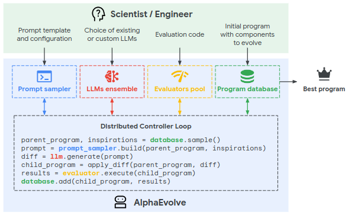
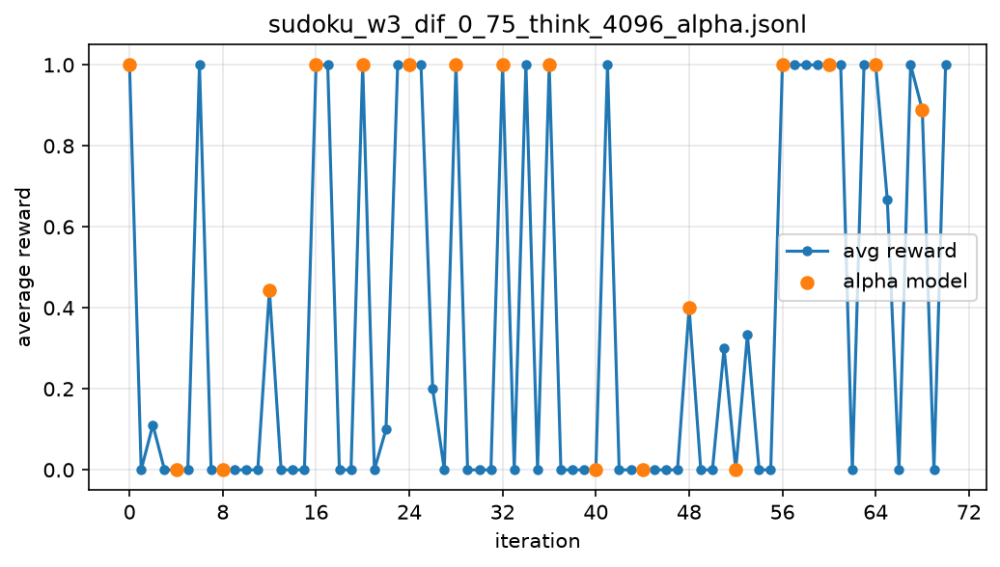
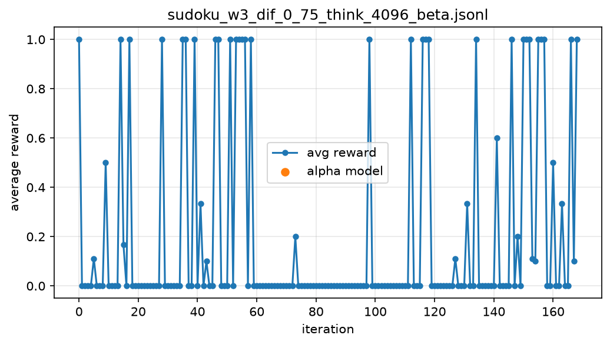
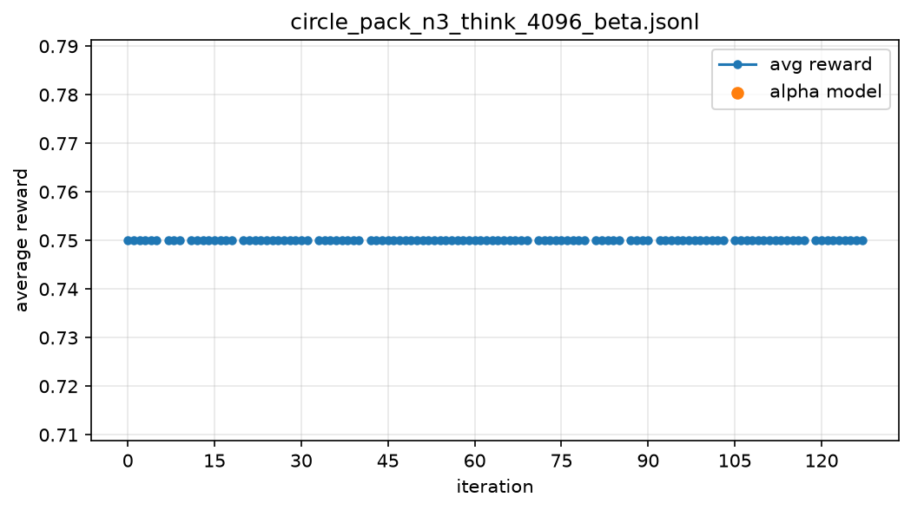
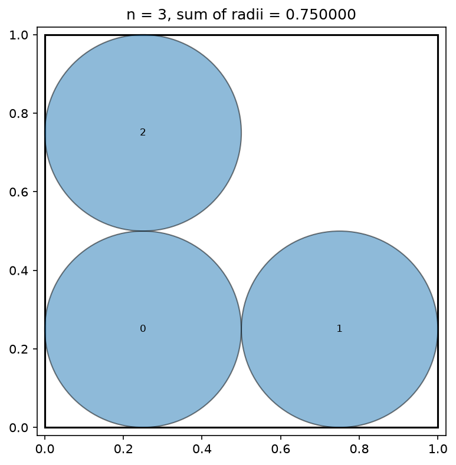
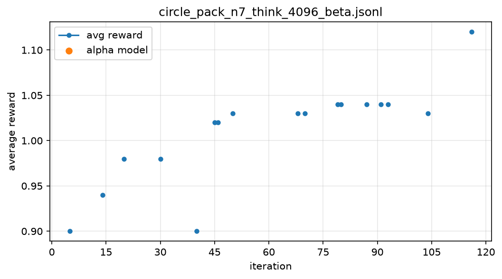
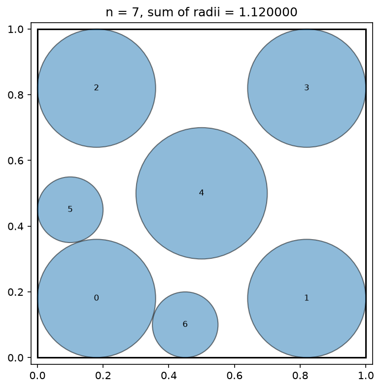
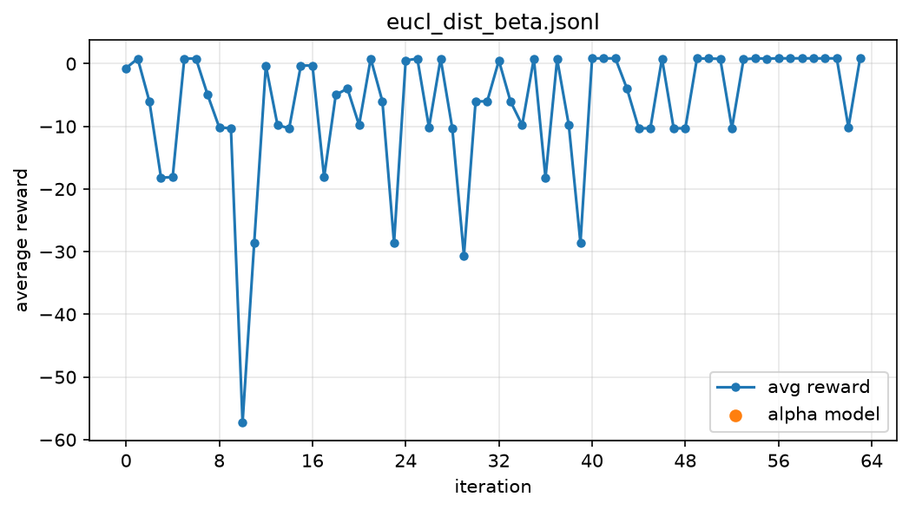
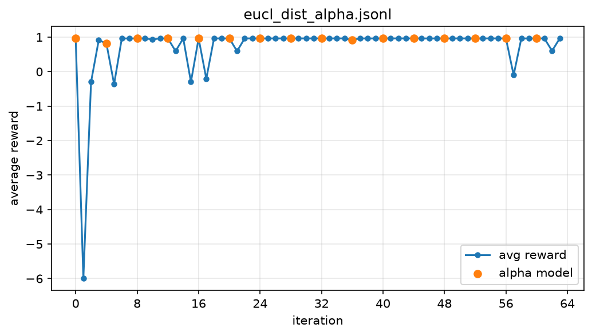

In this post, I would like to share my interpretation/reproduction of the 2025 paper "AlphaEvolve: A coding agent for scientific and algorithmic discovery" by Alexander Novikov et al. [1], along with the results I obtained. 
Below is the expanded view of the AlphaEvolve discovery process from the paper (fig. 2).



Figure 1 - Expanded view of the AlphaEvolve discovery process

The discovery process itself is surprisingly simple, especially compared to the kind of results it can achieve with a strong enough LLM ensemble. 
I believe the diagram speaks for itself, so no additional comments are needed from my side. 
This simple setup for program evolution allowed the paper's authors to find solutions better than the SOTA at the time for problems such as tensor decomposition, autocorrelation inequalities, uncertainty principles, Erdős’s minimum overlap problem, the kissing number problem, and packing problems. 

Using the paper's high-level idea as a reference for my minimal implementation (I did not look at their code at all), I defined the following search algorithm: 

```text
Algorithm 1: LLM Search with Lossy Hash Maps
─────────────────────────────────────────────────────────────
Input:  environment E, models M_α, M_β, iterations T,
        sample sizes n, m, temperature τ, alpha ratio α
Output: final state of E

 1: S ← ∅                                  ▷ lossy hash map of scored changes
 2: F ← ∅                                  ▷ lossy hash map of failed changes
 3: for t = 0 to T − 1 do
 4:     M ← M_α if t mod ⌊1/α⌋ = 0 else M_β
 5:     P ← SampleScored(S, n, τ)
 6:     Q ← SampleUniform(F, m)
 7:     x ← Prompt(E.instructions, E.state, P, Q)
 8:     C ← E.parse(M.generate(x | E.grammar))
 9:     for each c ∈ C do
10:         try   s ← E.step(c);  S.insert(c, s)
11:         catch e:              F.insert(c, e)
12:     if E.is_win() then break
13: return E.state

─────────────────────────────────────────────────────────────
Procedure SampleScored(S, n, τ)
 1: z ← (s − μ_s) / σ_s  for all s ∈ S
 2: p ← softmax(z / τ)
 3: return n entries drawn from S by p, without replacement

Lossy hash maps: fixed size, slot = FNV-1a(c) mod |S|, no chaining.
  S.insert keeps the higher-scoring entry on collision.
  F.insert overwrites on collision.
```

Key changes from the paper's implementation: 
1. The LLM ensemble is limited to just two models, alpha and beta. Alpha is meant to be the stronger model that pushes for breakthroughs, while beta, the less capable one, also proposes new solutions and refines the breakthrough solutions found by alpha. Note that the search algorithm can also use only the cheaper model all the time, turning off the alpha_ratio switching completely. 
2. The changes proposed by the model ensemble are stored in lossy hash maps. This way, the size of the database and of the score distribution stays bounded and does not grow indefinitely throughout the evolutionary search. When a hash collision happens for scored changes, the better-scoring change is kept, while failed changes simply overwrite the older ones. 
3. I split the database into two separate instances: scored changes and failed changes. As far as I know, the paper simply discards failed solutions. In my opinion, this is a mistake: the sampled prompt should show the model contrasting examples, both changes that score and changes that fail. This is especially important for the small models I can run with my compute, and it may stop a small model from looping indefinitely, submitting the same failed solutions again and again.  
4. While the paper samples scored changes with an algorithm inspired by MAP-Elites and island-based population models to balance exploration and exploitation, I take a much simpler approach. The scores are standardized and then turned into probabilities with the softmax function, with the temperature applied to the standardized scores before the softmax. Changing the temperature (lower to focus only on the top-scoring solutions, higher for more exploration) therefore directly tweaks the exploration/exploitation balance.   
5. Each environment defines a GBNF llama.cpp grammar that constrains the changes proposed by the model ensemble, which really helps with small models.
6. Given my compute limitations (16 GB RAM, a 3050 laptop GPU with 4 GB VRAM), I use quantized versions of the latest Gemma model releases, gemma-4-E4B-it-Q4_0.gguf and gemma-4-E2B-it-Q4_0.gguf, as the alpha and beta models respectively, and serve them with llama.cpp. The beta model is offloaded to the GPU, while the alpha model stays on the CPU in RAM. This setup makes evolutionary search possible with really limited compute. 

The code is available [here](https://github.com/panalexeu/nano_aevlv).

I defined the following environments for evolutionary search, inspired by the paper's problems: 
* Bin packing - a limited number of bins of a given size are available, and the items to be packed arrive according to some distribution (OR3 or Weibull). The goal is to define a heuristic (a Python function) that assigns items to bins online, using as few bins as possible; 
* Circle packing - packing circles in a unit square, maximizing the radii of the packed circles;  
* Symbolic regression - finding a formula from a limited set of symbols that best describes the provided data (e.g. Euclidean distance); 
* Sudoku - just a sudoku environment, which shows that the search converges on a task with a verifiable solution. 

### Results

Does this evolutionary search actually converge to a solution? Yes, it does. 

Below are the reward plots for two configs solving the sudoku environment: one using both the alpha and beta models, and one using only the beta model. The sudoku is 9x9 in size with difficulty 0.75 (75% of the 9^2 cells are empty). 

The models used are `gemma-4-E4B-it-Q4_0.gguf` for alpha and `gemma-4-E2B-it-Q4_0.gguf` for beta. 





Conclusions: 
1. The models cannot solve the sudoku puzzle in one iteration, even though the reasoning is not cut off. Therefore, the search loop makes it possible to solve a task that such small quantized models could not solve otherwise. Here is the reasoning trace (1,406 words) of the alpha model on the first iteration: 
```text
The user wants me to solve a Sudoku puzzle iteratively.
The current board state is:\n[[0 0 0 0 2 0 0 9 0]\n [0 0 0 0 3 9 0 0 7]\n [0 0 4 5 0 0 0 0 0]\n [0 0 0 0 0 0 0 0 0]\n [0 0 1 0 9 0 0 0 5]\n [0 4 0 7 0 8 0 0 0]\n [0 3 5 0 8 0 0 0 0]\n [0 0 0 2 0 0 4 0 0]\n [4 0 0 0 7 1 0 0 0]]
I need to find the next best move (a cell with 0) to fill. I will look for easy placements first.
Let's check 
...
If this is wrong, I'll backtrack. Let's try R7C4=5.
```
2. Both configs eventually converge to the final solution. 
3. The alpha config converges to the solution much faster: 70 iterations vs. 168 iterations for beta.
4. Let's leave compute aside and compare the number of iterations needed to solve this sudoku with a backtracking algorithm, whose worst case is O((n^2)^k), where n is the sudoku box size (n = 3 for 9x9) and k is the number of empty cells. So, in the worst case, backtracking would require O(9^60) ≈ 1.8e57 steps.

What about the other environments? 

Below are the discovered circle packing configurations along with their reward plots in pure reasoning mode (the models submitted circle positions directly, without being able to run code): 









For n = 3, the search wandered around a single solution, while for n = 7 some iterative improvement is visible. Note that the reward plots here are individual dots, since the models often submit broken packings with overlapping circles. This once again shows why a separate instance for failed changes was probably important.

Below are the reward plots for the symbolic regression environment discovering the Euclidean distance formula, for the alpha and beta-only configs (also in reasoning-only mode): 





I do not include plots for the bin packing problems, since none of the submitted solutions managed to beat the simple greedy heuristic of assigning each item to the fullest bin it fits in. 

I believe this might be one of my most useful projects, since with a really minimal codebase and limited compute it actually makes evolutionary search possible for some problems. If the right problem/environment is found, one that fits the reasoning capabilities of quantized Gemmas, I believe the search might converge to a good solution.

---

References: 
1. "AlphaEvolve: A coding agent for scientific and algorithmic discovery" by Alexander Novikov et al.