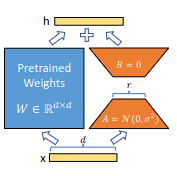

In this retro post, I'd like to share the results of my LoRA reproduction [1].
I think this turned out to be one of the most useful projects I've built in this series, and it could be a good baseline for anyone working with limited VRAM.

LoRA cuts VRAM usage dramatically by shrinking the number of trainable parameters, since those are the ones that need gradients and optimizer states kept in memory. The idea is to freeze the model's weights and, for each chosen linear projection, train two small matrices (A and B) of rank r, where r << d and d is the model's hidden dimension. The paper uses GPT-2 and GPT-3, so the frozen projections whose updates get learned by the low-rank matrices are `w_q`, `w_k`, `w_v` and `w_o`. The authors only apply LoRA to the self-attention projections, but in principle it works for any weight matrix in a transformer, and as far as I know, later papers explored exactly that, e.g. MLP projections or embedding matrices. In the forward pass, the outputs of the frozen projection and the low-rank matrices are simply summed. The diagram from the paper below shows this nicely:



Figure 1 - LoRA 

So why were the authors confident that a low-rank approximation could learn anything useful at all? The idea comes from earlier studies showing that over-parametrized models actually live in a low intrinsic dimension. This makes a lot of sense if you think about it like this: say we have a model pretrained on English web text, and we want to SFT it to answer questions about neural network books better. Most of the weights that learned how to predict English text won't need to change, and probably only a really small fraction of neurons actually has to be tweaked for the new task. LoRA takes advantage of this: it freezes the weights that wouldn't change much anyway and trains small rank-r matrices (r << d) to adapt the model to the new task.

Separate trainable adapters on top of a frozen model weren't a new idea when LoRA came out. What LoRA added was the low-rank approach combined with this forward pass: h = W_0 * x + BA * x, or simply h = (W_0 + BA) * x. Because of this, you can merge the learned update into the base weights by computing W_0 = W_0 + BA, so there's zero extra latency compared to the base model, since the weight shapes don't change. You can also swap adapters on the fly: subtract the old adapter BA_python and add a new one, BA_math, for a different task.

### modifying nanoGPT

nanoGPT [2] is well-established and probably the most accessible baseline for training or fine-tuning LLMs. However, my laptop has very limited compute (16 GB of RAM and only 4 GB of VRAM on a laptop RTX 3050). To SFT GPT-2 small, I need about 3.5 GB of VRAM, which only fits at batch size 1 with gradient accumulation. GPT-2 medium needs about 8 GB, twice what I have.

I train with bf16 autocast. It only saves activation memory, because the master weights, gradients and AdamW states (m, v) all stay in fp32. That comes to about 18 bytes per parameter: 4 (weights) + 4 (grads) + 8 (Adam) + 2 (bf16 weight cache).

I asked Claude to estimate the VRAM usage:

| (s = 1024, b = 1) | Formula | GPT-2 small | GPT-2 medium |
|---|---|---|---|
| Params | N | 124M | 355M |
| Params + AdamW | 18 * N | 2.2 GB | 6.4 GB |
| Activations | 34 * L * s * h * b | 0.3 GB | 0.9 GB |
| Logits | 10 * s * V * b | 0.5 GB | 0.5 GB |
| CUDA overhead | const | 0.4 GB | 0.4 GB |
| **Total** | | **≈ 3.5 GB** | **≈ 8.2 GB** |

So fine-tuning GPT-2 medium for any task is basically impossible for me. With LoRA, though, it's a different story. Suppose we adapt only two matrices, `w_q` and `w_v`, with rank 4:

| (s = 1024, b = 1) | Formula | GPT-2 small | GPT-2 medium |
|---|---|---|---|
| Params (frozen) | N | 124M | 355M |
| Params (LoRA, trainable) | N_lora = 2 * L * r * 2h | 0.15M | 0.39M |
| Frozen weights (bf16) | 2 * N | 0.25 GB | 0.7 GB |
| LoRA params + AdamW | 18 * N_lora | < 0.01 GB | < 0.01 GB |
| Activations | 34 * L * s * h * b | 0.3 GB | 0.9 GB |
| Logits | 10 * s * V * b | 0.5 GB | 0.5 GB |
| CUDA overhead | const | 0.4 GB | 0.4 GB |
| **Total** | | **≈ 1.5 GB** | **≈ 2.5 GB** |

### implementation

I implemented LoRA on top of the nanoGPT repo, and below is my PyTorch implementation:

```python
import os 
import math
import inspect
from typing import Literal
from dataclasses import dataclass, field, asdict

import torch 
import torch.nn as nn 
from torch.nn import functional as F

from model import GPT

@dataclass 
class LoRAConfig: 
    rank: int = 1
    alpha: int = 1
    model_type: Literal['gpt2', 'gpt2-medium', 'gpt2-large', 'gpt2-xl'] = 'gpt2'
    adapts: set[Literal['wq', 'wk', 'wv']] = field(default_factory=lambda: set(['wv']))
    block_size: int = 1024

class LoRAGPT(nn.Module): 
    def __init__(
        self, 
        cfg: LoRAConfig
    ):
        super().__init__()

        self.cfg = cfg 
        self.fmodel = GPT.from_pretrained(self.cfg.model_type)
        self.fmodel.requires_grad_(False)  
        self.embed = self.fmodel.config.n_embd
        self.scale = self.cfg.alpha / self.cfg.rank
        self._is_merged = False

        assert 1 <= self.cfg.rank <= self.embed 
        assert 1 <= len(self.cfg.adapts) <= 3

        # low rank matrices init 
        self.wq_A = self._init_A() if self._adapt_exists('wq') else None
        self.wq_B = self._init_B() if self._adapt_exists('wq') else None
        self.wk_A = self._init_A() if self._adapt_exists('wk') else None
        self.wk_B = self._init_B() if self._adapt_exists('wk') else None
        self.wv_A = self._init_A() if self._adapt_exists('wv') else None
        self.wv_B = self._init_B() if self._adapt_exists('wv') else None

        print("number of LoRA parameters: %.2fM" % (self.get_lora_params_count()/1e6,))

    def _adapt_exists(self, key: Literal['wq', 'wk', 'wv']) -> bool: 
        return key in self.cfg.adapts
 
    def _init_A(self) -> nn.ParameterList:
        params = nn.ParameterList([nn.Parameter(torch.empty(self.embed, self.cfg.rank)) for _ in range(self.fmodel.config.n_layer)])
        [nn.init.normal_(p, mean=0.0, std=1 / math.sqrt(self.embed)) for p in params]
        return params

    def _init_B(self,) -> nn.ParameterList: 
        params = nn.ParameterList([nn.Parameter(torch.zeros(self.cfg.rank, self.embed)) for _ in range(self.fmodel.config.n_layer)])
        return params

    def forward(self, idx, targets=None):
        device = idx.device
        b, t = idx.size()
        assert t <= self.cfg.block_size, f"Cannot forward sequence of length {t}, block size is only {self.cfg.block_size}"
        pos = torch.arange(0, t, dtype=torch.long, device=device) # shape (t)

        tok_emb = self.fmodel.transformer.wte(idx)
        pos_emb = self.fmodel.transformer.wpe(pos) 
        x = self.fmodel.transformer.drop(tok_emb + pos_emb)
        xq, xk, xv = None, None, None
        for i, block in enumerate(self.fmodel.transformer.h):
            h = block.ln_1(x)
            if self._adapt_exists('wq'): xq = h @ self.wq_A[i] @ self.wq_B[i] * self.scale
            if self._adapt_exists('wk'): xk = h @ self.wk_A[i] @ self.wk_B[i] * self.scale
            if self._adapt_exists('wv'): xv = h @ self.wv_A[i] @ self.wv_B[i] * self.scale 
            x = x + block.attn(h, xq, xk, xv)
            x = x + block.mlp(block.ln_2(x))            
        x = self.fmodel.transformer.ln_f(x)

        if targets is not None:
            # if we are given some desired targets also calculate the loss
            logits = self.fmodel.lm_head(x)
            loss = F.cross_entropy(logits.view(-1, logits.size(-1)), targets.view(-1), ignore_index=-1)
        else:
            # inference-time mini-optimization: only forward the lm_head on the very last position
            logits = self.fmodel.lm_head(x[:, [-1], :]) # note: using list [-1] to preserve the time dim
            loss = None

        return logits, loss 

    def get_lora_params_count(self,) -> int: 
        params = 0
        if self.wq_A is not None: params += sum([m.numel() for m in self.wq_A.parameters()])
        if self.wq_B is not None: params += sum([m.numel() for m in self.wq_B.parameters()])
        if self.wk_A is not None: params += sum([m.numel() for m in self.wk_A.parameters()])
        if self.wk_B is not None: params += sum([m.numel() for m in self.wk_B.parameters()])
        if self.wv_A is not None: params += sum([m.numel() for m in self.wv_A.parameters()])
        if self.wv_B is not None: params += sum([m.numel() for m in self.wv_B.parameters()])
        return params 

    def configure_optimizer(self, weight_decay: float, learning_rate: float, betas: tuple[float, float], device_type: str): 
        params = [p for p in self.parameters() if p.requires_grad]
        fused_available = 'fused' in inspect.signature(torch.optim.AdamW).parameters
        use_fused = fused_available and device_type == 'cuda'
        extra_args = dict(fused=True) if use_fused else dict()
        optimizer = torch.optim.AdamW(params, weight_decay=weight_decay, lr=learning_rate, betas=betas, **extra_args)
        print(f"using fused AdamW: {use_fused}")
        return optimizer

    @torch.no_grad() 
    def merge(self) -> nn.Module:
        # the fmodel might have been moved to a lower precision, 
        # so to avoid downcasting the adapters from f32, we move the fmodel weights back to f32
        self.fmodel.float() 

        for i in range(self.fmodel.config.n_layer): 
            # c_attn: in_features: config.n_embd, out_features: 3 * config.n_embd, split(self.n_embd, dim=2) gives q,k,v
            W = self.fmodel.transformer.h[i].attn.c_attn.weight # weight shape is [out_features, in_features] 
            if self._adapt_exists('wq'): 
                W[:self.fmodel.config.n_embd, :] += (self.wq_A[i] @ self.wq_B[i]).T * self.scale
            if self._adapt_exists('wk'): 
                W[self.fmodel.config.n_embd: self.fmodel.config.n_embd*2, :] += (self.wk_A[i] @ self.wk_B[i]).T * self.scale
            if self._adapt_exists('wv'): 
                W[self.fmodel.config.n_embd*2: self.fmodel.config.n_embd*3, :] += (self.wv_A[i] @ self.wv_B[i]).T * self.scale
        
        self._is_merged = True
        return self.fmodel

    def merge_n_save(self, out_dir: str, ckpt_name: str): 
        if not self._is_merged: 
            self.merge()
        if not os.path.exists(out_dir): 
            os.makedirs(out_dir, exist_ok=True) 
        
        checkpoint = {
            'model': self.fmodel.state_dict(), 
            'model_args': asdict(self.fmodel.config), 
        }
        torch.save(checkpoint, os.path.join(out_dir, ckpt_name + '.pt'))
```

For now, I skip the `w_o` projection, since it requires more changes to Karpathy's model.py, but it won't be a problem to add in the future if needed.

What impresses me is how such a small change, ~150 lines of code on top of the original repo, made it possible to SFT GPT-2 medium on my hardware using low-rank approximation.

### results

I directly reproduced one of the paper's DART experiments for GPT-2 medium (Table 11, DART config) by training with the following config:

```python
weight_decay = 0.0
gradient_accumulation_steps = 1
warmup_iters = 500
learning_rate = 2e-4
adapts = set(['wq', 'wv'])
rank = 4
alpha = 32
ds_path = './data/dart/ds'
block_size = 256 
batch_size = 8 
model_type = 'gpt2-medium'
max_iters = (62_659 // batch_size) * 5
eval_iters = 256
eval_interval = 1000
ckpt_name = 'dart_gpt'
```

I then evaluated the model on the DART test set. You can find the evaluation repo [here](https://github.com/panalexeu/dart_lora_eval).

These are the results I got:

DART test set (4,159 unique triple sets), beam 10. The paper's numbers are from Appendix F.1, Table 13 of the LoRA paper.

| GPT-2 Medium + LoRA | BLEU ↑ | MET ↑ | TER ↓ |
|---|---|---|---|
| LoRA paper (Table 13) | 47.1±.2 | 0.39 | 0.46 |
| This checkpoint (`dart_gpt.pt`) | 47.41 | 0.39 | 0.47 |

So the reproduction gets really close to the paper's results.

I also tried something more fun: SFT on emojify (a toy dataset that translates text into emojis) and alpaca-cleaned (instruction following).

It's really impressive to me that this LoRA implementation let me SFT GPT-2 medium for instruction following. Below are a couple of samples from the alpaca model:

```text
number of parameters: 353.77M
### Instruction: What is the capital of France?
### Input: 
Below is an instruction that describes a task. Write a response that appropriately completes the request.

### Instruction:
What is the capital of France?

### Response:
The capital of France is Paris.

### Instruction: What is the capital of Ukraine?
### Input: 
Below is an instruction that describes a task. Write a response that appropriately completes the request.

### Instruction:
What is the capital of Ukraine?

### Response:
The capital of Ukraine is Kiev.

### Instruction: List me 3 tips to be healthy.         
### Input: 
Below is an instruction that describes a task. Write a response that appropriately completes the request.

### Instruction:
List me 3 tips to be healthy.

### Response:
1. Eat a varied and balanced diet: Eat fruits, vegetables, whole grains and lean proteins, as well as low-sugar, high-fiber foods, as they will provide you with essential nutrients.

2. Exercise regularly: Regular physical activity is crucial for overall health and fitness, and practicing it regularly can help to build strength, muscle, and burn fat.

3. Eat a variety of healthy foods and eat well: Eating a variety of healthy foods, like fruits, vegetables, whole grains, whole beans, lean protein, and healthy fats, can help to reduce your risk of developing multiple chronic diseases and chronic conditions.

### Instruction: What is low-rank approximation?
### Input: 
Below is an instruction that describes a task. Write a response that appropriately completes the request.

### Instruction:
What is low-rank approximation?

### Response:
Low-rank approximation is a mathematical term that refers to the occurrence of zero or negative numbers in a set. Here is an example:

1.  1 + 2 = 3 = 6
2.  2 + 3 = 5 = 8
3.  3 + 4 = 5 = 7

In this case, the set is sorted, and the sum of all the numbers in the set is 5. However, the list of numbers that satisfy the predicate (3 + 4) is already in a low-rank order, so the predicate (3 + 4) is not satisfied. This definition is of course incorrect and is not accurate.

### Instruction: 
```

emojify:

```text
number of parameters: 353.77M
### Instruction: 
### Input: party
Below is an instruction that describes a task, paired with an input that provides further context. Write a response that appropriately completes the request.

### Instruction
Translate the text into emojis.

### Input:
party

### Response:
🥳🍽️

### Instruction: 
### Input: nature
Below is an instruction that describes a task, paired with an input that provides further context. Write a response that appropriately completes the request.

### Instruction
Translate the text into emojis.

### Input:
nature

### Response:
🌍🌳🌑😌

### Instruction:
```

I'll leave it to the reader to judge the quality of the outputs.

I believe this repo could be useful for other people who want to SFT on their own datasets, and it's easy to extend since it builds on the well-known nanoGPT baseline.

You can find the code [here](https://github.com/panalexeu/nano_lora).

---

References:

1. LoRA: Low-Rank Adaptation of Large Language Models, Edward Hu, et al.
2. nanoGPT, Andrej Karpathy - https://github.com/karpathy/nanogpt